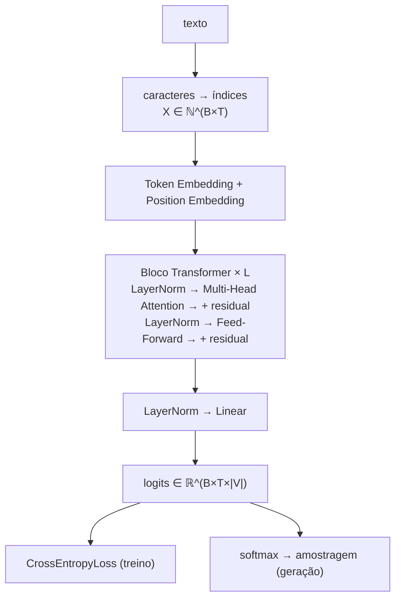
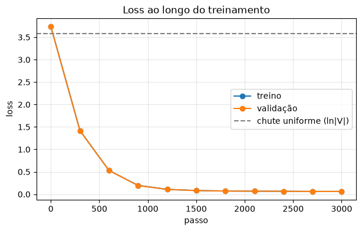

# MiniGPT

[](https://colab.research.google.com/github/LyanKaleu/MiniGPT/blob/main/MiniGPT.ipynb)


Um modelo de linguagem no estilo GPT construído **do zero em PyTorch**, num único notebook explicado passo a passo **em português**.

Nada vem pronto: a atenção causal, o multi-head attention, os blocos Transformer, o laço de treinamento e a geração de texto são escritos à mão, um de cada vez, com a matemática ao lado do código. O modelo tem cerca de 30 mil parâmetros e treina em uns dois minutos numa CPU comum.

## O que você vai ver

- **Tokenização por caracteres:** vocabulário, `encode` e `decode`.
- **Lotes para previsão do próximo token:** por que o alvo é a entrada deslocada uma posição.
- **Atenção causal:** $Q$, $K$, $V$, a escala $\sqrt{d_{head}}$ e a máscara que esconde o futuro.
- **Multi-head attention, feed-forward, LayerNorm e conexões residuais**, montados num bloco Transformer.
- **Treinamento com AdamW**, com a loss de treino e de validação acompanhadas num gráfico.
- **Geração autorregressiva:** softmax, amostragem e por que os erros se acumulam.

## Arquitetura



| Hiperparâmetro | Valor |
|---|---|
| Dimensão do embedding ($d$) | 32 |
| Contexto máximo ($T$) | 64 caracteres |
| Blocos Transformer ($L$) | 2 |
| Cabeças de atenção ($h$) | 4 |
| Tamanho do vocabulário | 36 caracteres |
| Parâmetros | 29.668 |
| Otimizador | AdamW, $\eta = 10^{-3}$, 3000 passos |

## Resultados

A loss cai do valor esperado para um chute aleatório ($\ln 36 \approx 3{,}58$) até cerca de **0,06**:



Texto gerado a partir do prompt `"O g"`:

```text
O gato dormia perto da porta.
No dia seguinte, tudo começava novameçava namente.

Era uma vez um gato que vivia em uma pequena casa.
O gato gostava de caminhar pelo jardim.
Todos os dias o gato observava os píarequela m vinm.
Era va uma gatela parto casa.
```

O modelo reproduz frases inteiras do texto de treino, mas também tem trechos embaralhados. O notebook explica de onde eles vêm.

## Limitações

O texto de treino é **um único parágrafo repetido 200 vezes**. Por isso o modelo *decora* esse parágrafo em vez de aprender português de forma geral, e a loss de validação baixa não prova generalização: treino e validação contêm as mesmas frases. Isso é proposital, porque mantém o treinamento rápido e fácil de conferir. O notebook discute essa limitação na seção 20.

## Como executar

**No navegador (recomendado):** clique no botão **Open in Colab** acima e use *Ambiente de execução → Executar tudo*. Não precisa de GPU.

**Localmente:**

```bash
git clone https://github.com/LyanKaleu/MiniGPT.git
cd MiniGPT
pip install -r requirements.txt jupyter
jupyter notebook MiniGPT.ipynb
```

Os resultados são reproduzíveis: o notebook fixa a semente aleatória (`torch.manual_seed(42)`).

## Próximos passos

- [ ] Treinar com um texto real em domínio público, como *Dom Casmurro*, de Machado de Assis.
- [ ] Adicionar temperatura e top-k à geração.
- [ ] Calcular todas as cabeças de atenção de uma vez (ou usar `F.scaled_dot_product_attention`).
- [ ] Adicionar dropout e aumentar o modelo.
- [ ] Trocar a tokenização por caracteres por BPE.

## Referências

- Vaswani et al., [*Attention Is All You Need*](https://arxiv.org/abs/1706.03762) (2017).
- Radford et al., [*Language Models are Unsupervised Multitask Learners*](https://cdn.openai.com/better-language-models/language_models_are_unsupervised_multitask_learners.pdf) (2019): GPT-2.
- Andrej Karpathy, [*Let's build GPT: from scratch, in code, spelled out*](https://www.youtube.com/watch?v=kCc8FmEb1nY) e [nanoGPT](https://github.com/karpathy/nanoGPT).

## Licença

[MIT](LICENSE)
